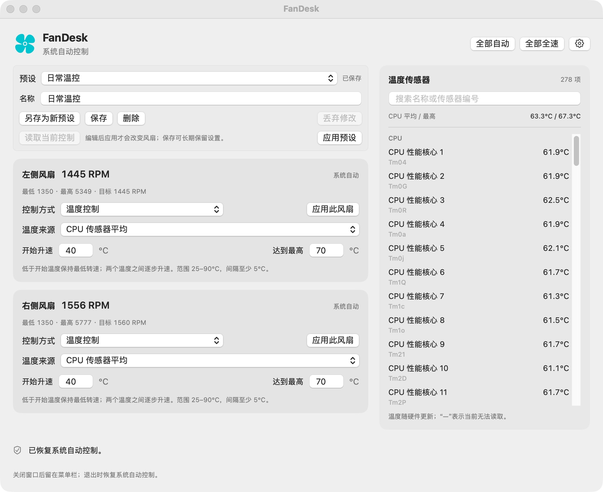

# FanDesk

原生 macOS 风扇控制工具。独立调节双风扇，在菜单栏查看温度，为不同场景保存预设。


[](LICENSE)

**[下载 0.2.2（已公证）](https://github.com/sivdead/FanDesk/releases/download/v0.2.2/FanDesk-0.2.2-macos-arm64-notarized.dmg)** · [版本说明](https://github.com/sivdead/FanDesk/releases/tag/v0.2.2) · [安装指南](docs/installation.md) · [提交问题](https://github.com/sivdead/FanDesk/issues)



## 功能

- **独立控制** — 每个风扇分别选择系统自动、固定转速或温度控制。
- **温度曲线** — 自选传感器，设置开始升速与达到最高转速的温度。
- **平滑调速** — 平滑短时温度波动，缓慢降低转速，高温保护仍立即生效。
- **传感器监测** — 查看 CPU、GPU、电池、SSD 等温度，支持分类和搜索。
- **命名预设** — 保存、切换、重命名和删除设置，保留未保存修改提示。
- **菜单栏操作** — 查看温度和转速，切换预设，快速恢复自动控制。
- **启动与恢复** — 支持登录启动、隐藏窗口，以及启动和唤醒时恢复设置。

退出、连接中断或控制失败时，FanDesk 会尝试将风扇交回系统管理。固定转速受硬件上下限约束；手动控制期间保留高温保护。

## 安装

1. 从 [Releases](https://github.com/sivdead/FanDesk/releases/tag/v0.2.2) 下载 `FanDesk-0.2.2-macos-arm64-notarized.dmg`。
2. 打开磁盘映像，将 **FanDesk.app** 拖入 **Applications**，再从“应用程序”打开。
3. 点击 **启用风扇控制**，按系统提示允许 FanDesk 后台运行。
4. 选择预设或编辑两个风扇的设置，点击 **应用**。

> 官方公证安装包已使用 Developer ID 正式签名并通过 Apple 公证，应用和磁盘映像均附带离线公证凭证。首次打开按 macOS 的正常来源确认提示操作，风扇控制仍需系统后台授权。[首次授权、升级与卸载说明 →](docs/installation.md)

## 兼容性

| 项目 | 当前范围 |
| --- | --- |
| 架构 | Apple Silicon（arm64），双风扇机型 |
| 系统 | 最低构建目标 macOS 14；已实测 macOS 27.0.1 |
| 已验证硬件 | Apple M5 Pro · Mac17,8 |
| 界面语言 | 简体中文 |

FanDesk 仍处于早期阶段，其他机型和旧系统尚未完成验证。无风扇、单风扇和 Intel Mac 当前不在支持范围内。传感器名称与可用项会随硬件变化，完整验证范围见 [测试与兼容性记录](docs/validation.md)。

## 从源码构建

需要 Xcode Command Line Tools 和 Swift 6.4。

```sh
git clone https://github.com/sivdead/FanDesk.git
cd FanDesk
bash scripts/build.sh
```

应用输出到 `build/FanDesk.app`，构建脚本会同时运行自动检查。源码构建默认采用本地签名。打包磁盘映像：

```sh
bash scripts/package.sh
```

开发环境、测试命令和代码结构见 [开发指南](docs/development.md)。

## 参与贡献

欢迎提交问题、机型兼容性反馈和 Pull Request。请附上 Mac 型号、系统版本、FanDesk 版本及复现步骤，具体见 [贡献指南](CONTRIBUTING.md)。

## 致谢

SMC 读写实现基于 [adilkairolla/fan-control](https://github.com/adilkairolla/fan-control) 的 MIT 许可代码，保留了 [来源声明](ThirdParty/NOTICE.txt) 和 [原始许可](ThirdParty/fan-control-LICENSE)。FanDesk 是独立项目。

## 许可证

FanDesk 采用 [MIT License](LICENSE)。允许使用、修改和分发，包括商业用途；请保留相应版权声明和许可文本。第三方代码保留各自的版权声明。
